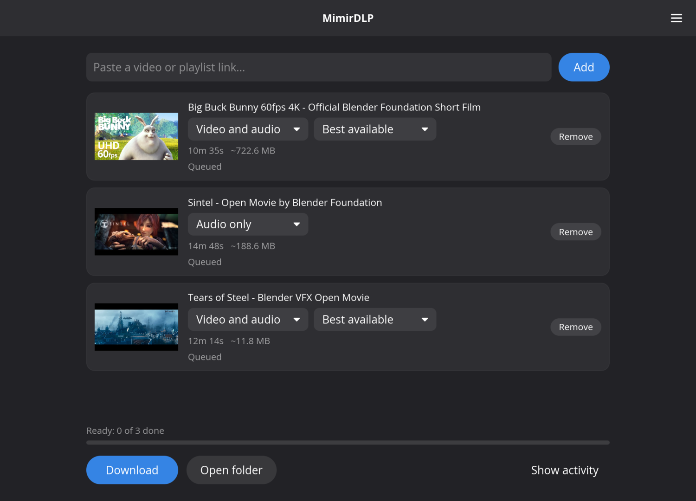

# MimirDLP

Download videos and music from YouTube and most other sites, with a simple window instead of a command line.

## Download

| Windows | Linux |
|---|---|
| [`mimirdlp-<version>-windows-x86_64.zip`](https://github.com/indep-arg/MimirDLP/releases/latest) | [`mimirdlp-<version>-linux-x86_64.tar.gz`](https://github.com/indep-arg/MimirDLP/releases/latest) |

No installer: extract it anywhere (not `Program Files`) and run `mimirdlp`. Everything it needs stays in that folder.

## How to use it

1. Open MimirDLP. The first time, it downloads the tools it needs by itself (about 200 MB).
2. Paste a link and pick video or audio and the quality.
3. Press **Download**.

Subtitles, SponsorBlock, playlists and signed-in downloads are in **Settings**, in the ☰ menu. It runs on [yt-dlp](https://github.com/yt-dlp/yt-dlp), so it works wherever yt-dlp does.

## Something not working?

Open ☰, **Setup and updates**, and check for updates first: an old yt-dlp is the usual reason a site stops working. More help, every option explained, and how to build it yourself are in the [guide](docs/GUIDE.md).

## Languages

English and Spanish so far, following your system's language (or pick one in the ☰ menu). Want MimirDLP in your language? See [translating](docs/TRANSLATING.md).

## License

[MIT](LICENSE). yt-dlp, FFmpeg and Deno have their own licenses. Use it responsibly and within the law and each site's terms; you are responsible for what you download.
