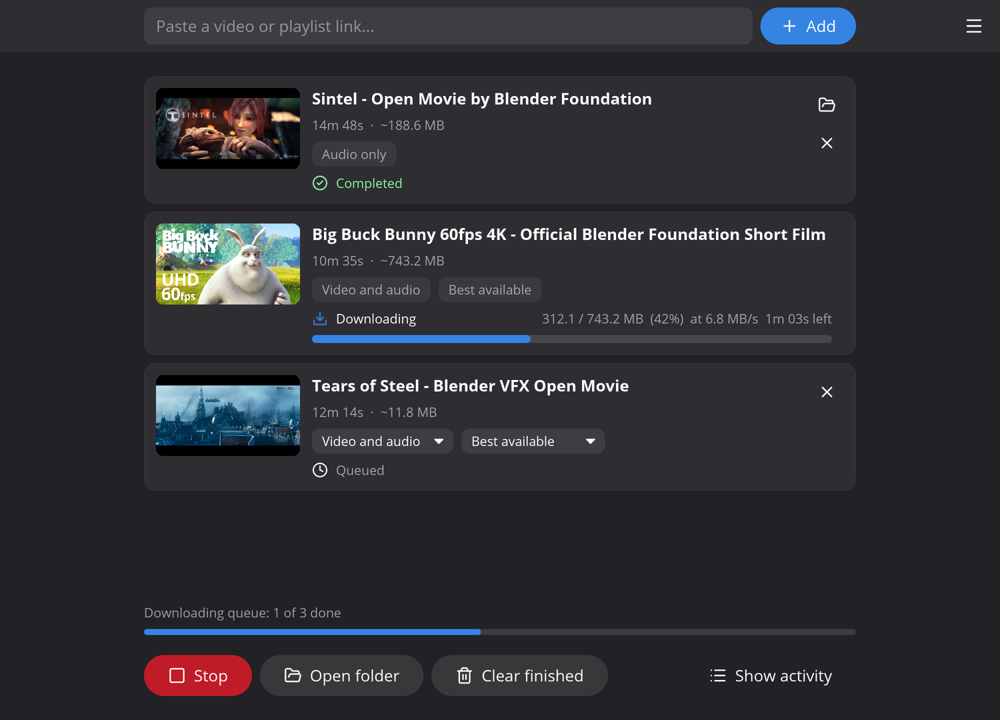

# MimirDLP

A window for [yt-dlp](https://github.com/yt-dlp/yt-dlp): paste a link, choose video or audio, press Download.

## Install

Get the file for your system from the [latest release](https://github.com/indep-arg/MimirDLP/releases/latest), extract it wherever you like and run `mimirdlp`. There is no installer.

| System  | File      | Needs |
|---------|-----------|-------|
| Windows | `.zip`    | Windows 10 or later |
| Linux   | `.tar.gz` | glibc 2.39 or newer: Ubuntu 24.04, Mint 22, Fedora 40, Debian 13, Arch, openSUSE Tumbleweed |

Not sure about your Linux? `ldd --version` prints the glibc version on its first line.

The first time it opens, MimirDLP downloads yt-dlp, FFmpeg and Deno (about 200 MB) into its own folder. Nothing is added to your system. If that folder can't be written to (`Program Files`, for example), it uses your user folder instead.

Windows may warn that the app is unknown, because it isn't code signed yet: choose **More info**, then **Run anyway**.

## Use

1. Copy a link and switch to MimirDLP: the link is already in the box (Ctrl+V works too). Press **Add**.
2. Choose video or audio, and the quality, on the card that appears.
3. Press **Download**.

It works on every site yt-dlp supports. Subtitles, SponsorBlock, playlists and signed-in downloads are under **Settings**, in the ☰ menu.

## When a site stops working

It is nearly always an old yt-dlp. Open ☰, **Setup and updates**, and press **Check for updates**.

The [guide](docs/GUIDE.md) covers the rest: every option, common problems and building from source.

## Languages

English and Spanish so far. MimirDLP follows your system's language, and the ☰ menu lets you pick another. Translations are done on [Weblate](https://hosted.weblate.org/engage/mimirdlp/), where anyone can help without touching code; see [translating](docs/TRANSLATING.md).

## License

[MIT](LICENSE). yt-dlp, FFmpeg and Deno have their own licenses. What you download is your responsibility: respect the law and each site's terms.
